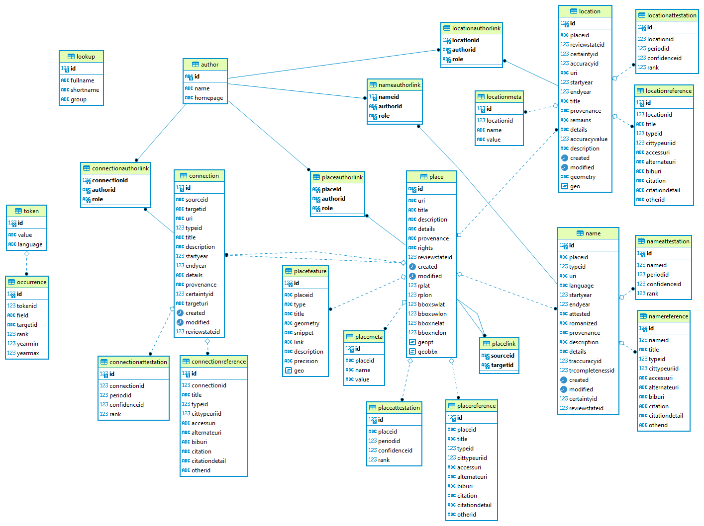

# Pleiades Wrapper API

- [Pleiades Wrapper API](#pleiades-wrapper-api)
  - [Quick Start](#quick-start)
    - [Prerequisites](#prerequisites)
    - [Procedure](#procedure)
  - [Database Schema](#database-schema)
  - [Authentication](#authentication)
  - [Indexing Text for Search](#indexing-text-for-search)
  - [Searching](#searching)
  - [API Reference](#api-reference)
    - [Conventions](#conventions)
    - [Lookup](#lookup)
    - [Quick Search](#quick-search)
    - [Place Details](#place-details)
    - [Nearby Places](#nearby-places)
    - [Authentication and Accounts](#authentication-and-accounts)
    - [Diagnostics](#diagnostics)
  - [CLI Tool](#cli-tool)
    - [Build Index Command](#build-index-command)
    - [Build Query Command](#build-query-command)
    - [Bulk Export Command](#bulk-export-command)
    - [Create Database Command](#create-database-command)
    - [Import Graph Command](#import-graph-command)
    - [Populate Spatial Data Command](#populate-spatial-data-command)
    - [Scan Graph Command](#scan-graph-command)
    - [Validate Geometries Command](#validate-geometries-command)
  - [Pleiades Overview](#pleiades-overview)
    - [Model](#model)
    - [Search](#search)
    - [JSON File](#json-file)

Thus project includes a CLI tool to import the Pleiades JSON dataset from its full-blown JSON file dump into a specially designed PostgreSQL database; a core search layer; and an API wrapper.

The initial development plan is targeted to a limited set of search functions. A later stage will include more, and possibly extend to other gazetteers where required.

Useful links:

- <www.pleiades.stoa.org>: ancient geography, especially Greek and Roman world. Graph database, no RDBMS. No real API except for getting details from a PID.
- <www.mapbox.com>: the Pleiades site uses MapBox. [Angular MapBox](https://medium.com/@timo.baehr/using-mapbox-in-angular-application-bc3b2b38592).
- [Huge JSON Viewer](https://github.com/WelliSolutions/HugeJsonViewer), [Dadroit JSON Viewer](https://dadroit.com/).

## Quick Start

### Prerequisites

The only prerequisite is having a PostgreSQL service including **PostGIS**.

💡 To launch a PostgreSQL service without installing it, I prefer to use a ready-made Docker also including [PostGIS](https://postgis.net/install/). You can easily run a container like this (in this sample, I created a folder in my drive at `c:\data\pgsql` to host data outside the container):

```bash
docker run --volume postgresData://c/data/pgsql -p 5432:5432 --name postgres -e POSTGRES_PASSWORD=postgres -d postgis/postgis
```

>If you already have a PostgreSQL service instance and you want to keep it unchanged, you can just change the container's name and use the same port (stopping the other instance) or a different one (in this case, update the connection string in `appsettings.json`), e.g.: `docker run --volume postgresData://c/data/pgissql -p 5432:5432 --name postgis -e POSTGRES_PASSWORD=postgres -d postgis/postgis`.

### Procedure

💡 During this procedure you will import and progressively enrich data. If you want to take a snapshot at a specific step, just dump the resulting database like:

```bash
pg_dump --username=postgres -f c:/users/dfusi/desktop/pleiades.sql pleiades
```

If you do not have the pgsql client tool, you can install client tools only from the official package [setup](https://www.enterprisedb.com/downloads/postgres-postgresql-downloads), or for Ubuntu use `sudo apt install postgresql-client`.

Should you want to manually create an empty database (e.g. for restoring tables into it):

```sql
create database pleiades
with owner "postgres"
encoding 'UTF8'
lc_collate='en_US.UTF-8'
lc_ctype='en_US.UTF-8'
template template0;
```

The following procedure will create a database from scratch. You just require:

- the Pleiades JSON [data file](http://atlantides.org/downloads/pleiades/json/).
- the [indexing profile](./pleitool/Assets/Profile.json).
- a running PostgreSQL with PostGis service.

▶️ (1) **download** the latest Pleiades JSON dataset from [this page](http://atlantides.org/downloads/pleiades/json/), and unzip it in some folder. This is a single huge JSON file.

▶️ (2) ensure that your **database** service is running, and that the connection string in `appsettings.json` is correct.

▶️ (3) **import** the JSON file into a database named `pleiades` (you can pick whatever name you want; the database name here is not specified as we're going to use the default `pleiades` name -- you can change it with option `-d` for all the commands involving a database name):

```bash
./pleitool import-graph c:/users/dfusi/desktop/pleiades-places.json
```

>This process will usually take some minutes, according to your hardware. This is the longest process, as it reads the huge JSON file sequentially. I've not taken care of too complex optimizations here, as I'm not going to use the full import very often (e.g. once a month). You may want to add an import limit (e.g. `-l 100`) to import only a few places and complete the procedure to check it before launching the importer for the full dataset. You can also try with dry mode first, which does not touch the database, by adding the `-p` (=preflight) option.

▶️ (4) have the Pleiades [Embix](https://github.com/vedph/embix) **profile** somewhere ready on your machine. You can find it in this repository under `pleitool/Assets`. In this example, I placed it on my Windows desktop with name `pleiades-profile.json`.

▶️ (5) create the text **index** inside the database using the Embix profile:

```bash
./pleitool index c:/users/dfusi/desktop/pleiades-profile.json -c
```

This command provides several options for optimizations and multithreading, but usually a couple of parallel running threads (the default) is fine.

You will find that your `pleiades` database now has two more tables: `eix_token` and `eix_occurrence`.

▶️ (6) populate the spatial columns in the `pleiades` database with this command:

```bash
./pleitool pop-spatial
```

This completes the import procedure.

FYI, the last step executes the [Spatial.pgsql](./pleitool/Assets/Spatial.pgsql) script to _populate the spatial columns_ with data parsed from the imported fields: `place.geo_pt` from the representative point, `place.geo_bbx` from the bounding box SW/NE corners (a point when they coincide), and `geo` in `place_feature` and `location` from their GeoJSON geometries. Places without a location have 0,0 as their coordinates in the dataset: their spatial columns are left NULL, and the API returns null coordinates for them. The script can be run more than once. After populating spatial data, the command also creates all the missing database indexes (see [Indexes.pgsql](./Pleiades.Ef/Assets/Indexes.pgsql)) and refreshes the database statistics, so you can also use it to upgrade databases created by previous versions.

The database requires the `postgis` and `pg_trgm` extensions, which are created by the schema script.

You can now execute typical queries like this:

```sql
SELECT p.id, p.title, ST_AsText(p.geo_pt) AS geo_pt
FROM place p
WHERE p.id IN (
  SELECT o.target_id FROM eix_token t
  INNER JOIN eix_occurrence o ON o.token_id = t.id
  WHERE t.value = 'epidauros' AND o.field IN ('plttl','lcttl','nmrmz')
)
ORDER BY p.title, p.id
LIMIT 20;
```

Among other results, you will find [Epidauros](https://pleiades.stoa.org/places/570228/), like in this snapshot:

| id        | title                                            | geo_pt                                        |
|-----------|--------------------------------------------------|-----------------------------------------------|
| 570228    | Epidauros                                        | POINT (23.16015635 37.6334625)                |
| 570229    | Epidauros Limera                                 | POINT (23.033451 36.732711)                   |
| 570127    | Sanctuary of Asklepios at Epidauros              | POINT (23.074264194567963 37.598302342957034) |
| 671846980 | Theater at the Sanctuary of Asklepios, Epidauros | POINT (23.079196 37.595976)                   |
| 995644788 | Tholos at the Sanctuary of Asklepios, Epidauros  | POINT (23.074049189295664 37.59841317509734)  |

💡 You can use the `query` command of `pleitool` to build SQL queries according to a set of filters.

▶️ (7) if you want to create the binary files to be imported by the API, run the export command like:

```bash
./pleitool export c:/users/dfusi/desktop/pleiades-dump/
```

Quick reference for backup/restore:

👉 Backup:

```bash
pg_dump --username=postgres -f c:/users/dfusi/desktop/pleiades.sql pleiades
```

👉 Restore (first create an empty `pleaides` database):

```bash
psql -U postgres -d pleiades -f c:/users/dfusi/desktop/pleiades.sql
```

## Database Schema

This diagram represents the schema I have designed to contain most of the Pleiades dataset in a RDBMS, for easy usage by a wrapper API.



The database schema represents most of the data from the JSON file, more normalized and compact. Such data are an overkill for a simple geocoding API. Yet, it's often wiser to drop the least amount of data, at least in the import stage, especially for specialized gazetteers like Pleiades. This allows for more growth potential, and also helps in better understanding the model of each resource.

The original model is a graph, where a number of nodes originate from a central node representing a _place_. The node is connected to:

- _location_ nodes, which locate a place in physical space.
- _name_ nodes, which attribute a name to a place.
- _connection_ nodes, which define connections between places.

Also, a number of reference nodes can be assigned to various nodes to represent _references_ and _attestations_.

The RDBMS design represents most of the data in the original set, centered around the _place_ table. This table has a number of connected tables, which represent either the other most important entities (location, names, connections), or some other data, often connected to the place in a one-to-many relationship.

Having no clues about the details of this encoding, the import tool is designed to be easy to modify and adapt to the results of its execution. Its architecture has 3 main components:

- a place _reader_, which reads one place at a time from the JSON dataset file.
- a place _adapter_, which remodels the places read into a form more suitable to the target database.
- a place _writer_, which writes the remodeled places into the target database.

Thus, the same component can be used in different contexts, or possibly be replaced with others, without disrupting the import flow. For instance, the reader is not only used to import data, but also to scan them and get some details about their shape. For instance, this is used to determine the lengths of the various text fields, and their nullability.

Also, in most cases the graph redundancy is systematically reduced also with relation to entity details. For instance, not only in many cases entities have string fields repeating the same value thousands of times (e.g. `published` vs. `pending` for their review state); but often they come in pair, with a full URI value (like `https://pleiades.stoa.org/vocabularies/place-types/settlement`) side by side with its human-friendly, non-unique short form (`settlement`).

In the latter case, the general approach is mapping each URI to a numeric value, stored only once, together with the short form when present. This way, all the references to these URIs will be much more compact _inside_ the database, without losing the corresponding full URI and its eventual short form.

Thus, both the reader and the adapter share a lookup set with those mappings. This not only applies to the URI/short form pairs, but also to all those strings belonging to a rather finite set, like `published` vs. `pending`. In this case, an additional datum in the lookup model is used to group the entries under some specific heading. In the case of review state, the group is `state`, and 2 entries happen to belong to it: one with `published`, and another with `pending`.

For instance, a URI from a RDF vocabulary will look like this:

- ID=`1`
- fullName=`https://pleiades.stoa.org/vocabularies/place-types/settlement`
- shortName=`settlement`
- group=none

Whereas the two sampled entries about review state will be for `published`:

- ID=`7`
- fullName=`published`
- shortName=none
- group=`state`

and, for `pending`:

- ID=`413`
- fullName=`pending`
- shortName=none
- group=`state`

As you can see, the numeric IDs are totally meaningless and their only purpose is providing an internal identifier whithin the boundaries of the database. When dealing with the external world, we will rather output URIs and/or their friendly short names, just like in the original dataset.

## Authentication

The Pleiades data endpoints are anonymous. The API also includes the standard authentication, accounts and users endpoints from `Fusi.Api.Auth.Controllers` (see the [API reference](#authentication-and-accounts)), using JWT bearer tokens configured in the `Jwt` section (`SecureKey` must have at least 32 characters; optional `ExpirationMinutes` and `ClockSkewSeconds`). Stock users are seeded from `StockUsers`. In production, set secrets via environment variables (e.g. `Jwt__SecureKey`).

## Indexing Text for Search

Indexing text for search is implemented directly inside the database, with two additional tables, for the tokens (`eix_token`) and their occurrences (`eix_occurrence`).

As we need to provide a word-based text search, with proper filtering and tokenization, directly inside the database and strictly connected to other data, this project uses my [Embix](https://github.com/vedph/embix) indexing subsystem.

In addition to the basic Embix index, we want some more metadata for each occurrence: rank (calculated from various metadata, like review state, certainty level, etc.) and start/end years. Embix being designed for this type of extension, this project just has to provide these resources:

- an Embix _profile_ (see under project `pleitool/Assets`). This tells Embix which fields from which tables should be indexed, and how each field gets filtered and tokenized. Also, additional metadata for occurrences are defined here.
- a special _filter for languages_. This is specific to Pleiades data, where language codes, where applicable, mostly are inspired by 2-characters ISO 639 codes, but seem to be used with some freedom (e.g. `ca-valencia` besides `ca`, or even `etruscan-in-latin-characters`). So, here a special filter is provided (`LanguageTextFilter`) to flatten these codes into 5-characters codes. Anyway, currently we do not take advantage of this filter as the language datum is not consistent across the dataset; it happens to be specified for names only, so that words taken from other sources have no language specified and thus cannot be compared.
- a _metadata supplier_ (`PleiadesMetadataSupplier`), used to calculate the rank for some data according to their context.
- a _table initializer_, which replaces the default initialization for the occurrence table with one having some additional fields.

Thanks to the usage of this sub-system, we can thus embed a ready-to-use text index with minimal effort.

For Pleiades I currently define 3 Embix documents (see `pleitool/Assets/Profile.json` for the full profile). As Embix 5 streams all the records with a single reader to its parallel workers, data queries require no paging nor ordering. Unknown years (0-0 in Pleiades) are indexed as NULL:

```json
{
  "Documents": [
    {
      "Id": "place",
      "CountSql": "SELECT COUNT(*) FROM place;",
      "DataSql": "SELECT title AS plttl, description AS pldsc, details AS pldtl, review_state_id AS m_state, title AS m_raw_title, id AS m_target_id FROM place;"
    },
    {
      "Id": "location",
      "CountSql": "SELECT COUNT(*) FROM location;",
      "DataSql": "SELECT title AS lcttl, CASE WHEN start_year=0 AND end_year=0 THEN NULL ELSE start_year END AS m_year_min, CASE WHEN start_year=0 AND end_year=0 THEN NULL ELSE end_year END AS m_year_max, certainty_id AS m_certainty, review_state_id AS m_state, place_id AS m_target_id FROM location;"
    },
    {
      "Id": "name",
      "CountSql": "SELECT COUNT(*) FROM name;",
      "DataSql": "SELECT romanized AS nmrmz, attested AS nmatt, description AS nmdsc, CASE WHEN start_year=0 AND end_year=0 THEN NULL ELSE start_year END AS m_year_min, CASE WHEN start_year=0 AND end_year=0 THEN NULL ELSE end_year END AS m_year_max, review_state_id AS m_state, romanized AS m_raw_romanized, place_id AS m_target_id FROM name;",
      "TokenMultipliers": {
        "nmatt": "grc-rom"
      }
    }
  ]
}
```

Here, all data are filtered through a chain including tag filter, separator filter, whitespace filter, and standard filter.

- the `place` document draws data from the `place` table (e.g. "Epidaurus", having Pleiades ID 570228).
- the `location` document draws data from the `location` table (e.g. the location of the theatre in Epidaurus). Its years are the time span where the location is relevant.
- the `name` document draws data from the `name` table (e.g. Epidaurus has a couple of names: `Epidauria` and `Epidauros`, both spanning from 750 BC to 300 AD). Also, note that here I store the non-filtered romanized name, already included in the `nmrmz` field, as a metadatum named `m_raw_romanized`. This is because the Pleiades metadata supplier requires the non-filtered value to calculate the rank for the name. In fact, some dubious names happen to be marked with a question mark in this field. When this happens, the rank value (ranging from 0 to 100) gets reduced by 50. This could not be calculated from the filtered name value, where any question mark would be removed.

All these documents will be the source for the list of tokens and occurrences; each occurrence will have its field code equal to one of the following:

- `plttl`: from `place.title`
- `pldsc`: from `place.description`
- `pldtl`: from `place.details`
- `lcttl`: from `location.title`
- `nmrmz`: from `name.romanized`
- `nmatt`: from `name.attested`
- `nmdsc`: from `name.description`

The target ID for all the occurrences is always the place ID (as specified by `place_id AS m_target_id` in all the documents).

## Searching

Once you have the database filled with data and text index, the API provides search and data endpoints: see the [API reference](#api-reference) for their full documentation. This section describes how searches are implemented.

The SQL is built by `QuickSearchBuilder`: each text token yields a query for the IDs of the places having a matching token occurrence in the requested scopes, ranks and years; these are combined with `INTERSECT` (AND) or `UNION` (OR) in a CTE, and place-level filters (types, spatial) are applied once to the resulting places. All the values are passed as parameters. For instance, for `text=via ^=appi&yearMin=-300`:

```sql
WITH m AS (
SELECT o.target_id FROM eix_token t INNER JOIN eix_occurrence o ON o.token_id=t.id
WHERE ("t"."value" = @p0) AND (o.year_max >= @p1)
INTERSECT
SELECT o.target_id FROM eix_token t INNER JOIN eix_occurrence o ON o.token_id=t.id
WHERE ("t"."value" ILIKE @p2) AND (o.year_max >= @p3)
)
SELECT p.id, p.title, ...
FROM place p
WHERE p.id IN (SELECT m.target_id FROM m)
ORDER BY p.title, p.id
LIMIT @p4 OFFSET @p5;
```

💡 You can use the `query` command of `pleitool` to build SQL queries according to a set of filters.

The database indexes are designed for these queries: token searches use B-tree, pattern and trigram indexes on `eix_token.value`; occurrences are found via a covering index on `(token_id, field, target_id)` including rank and years (index-only scans); place types via `place_meta (place_id, name)`; distances and nearest-neighbor sorting via a GiST index on `place.geo_pt` (geography); bounding boxes via a GiST index on `place.geo_bbx::geometry`. All the foreign keys are indexed too.

## API Reference

This section documents all the API endpoints, for clients like a frontend app. The interactive reference (OpenAPI, generated from the code) is available at `/scalar/v1` (UI) and `/openapi/v1.json` (document) when the API is running.

### Conventions

- **Base URL**: all the endpoints are under `api/` (e.g. `http://localhost:5000/api/qsearch`).
- **JSON**: requests and responses use camel-case JSON property names. Dates are ISO 8601 strings. Missing values are `null` (never empty strings), and lists are empty arrays (never `null`).
- **Authentication**: the Pleiades data endpoints are **anonymous**. Only the [account and user endpoints](#authentication-and-accounts) require a JWT, passed as `Authorization: Bearer <token>`.
- **CORS**: only the origins listed in the `AllowedOrigins` setting are allowed (default `http://localhost:4200`). Credentials are allowed, and the `Token-Expired` header is exposed.
- **Coordinates** are WGS84 (EPSG:4326) longitude and latitude in decimal degrees. **Distances** are in meters, measured on the spheroid. **Years** are integers, negative for BC (e.g. `-300` = 300 BC); there is no year 0, which in parameters means "not set".
- **Caching**: data change only when the database is re-imported, so responses have a `Cache-Control` max-age: 1 hour for lookup, places and nearby places; 10 minutes for searches. Clients may cache them accordingly.
- **Rate limiting**: when enabled (`RateLimit` settings), requests beyond the limit per user (or per IP address for anonymous requests) in the configured time window get a `429 Too Many Requests` with body `{"error": "Too many requests. Please try again after N minute(s)."}`.
- **Cancellation**: aborted requests (e.g. superseded type-ahead searches) cancel their database queries.

#### Paged Results

Paged endpoints return a `DataPage` object:

| property     | type    | description                                         |
|--------------|---------|-----------------------------------------------------|
| `pageNumber` | integer | the page number (1-N).                              |
| `pageSize`   | integer | the page size (0 when all the items were requested). |
| `total`      | integer | the total count of the items matching the request.  |
| `pageCount`  | integer | the total count of pages.                           |
| `items`      | array   | the items in this page.                             |

Paging parameters are `pageNumber` (1-N, default 1) and `pageSize` (default 20, maximum 100).

#### Errors

Errors are returned as [problem details](https://www.rfc-editor.org/rfc/rfc9457) (`application/problem+json`):

- `400 Bad Request`: invalid parameters. The `errors` object maps each invalid parameter name to its error messages, so that a client can show them next to the corresponding input:

```json
{
  "type": "https://tools.ietf.org/html/rfc9110#section-15.5.1",
  "title": "One or more validation errors occurred.",
  "status": 400,
  "errors": {
    "Sort": ["Sorting by distance requires the distance point"],
    "Scopes": ["Invalid scope(s): foo"]
  },
  "traceId": "00-de82ef55c16f928b9719223780bf2188-20cce3ce2b982410-00"
}
```

- `401 Unauthorized`: missing, invalid, or expired token (in this case, the response has header `Token-Expired: true`, and the client should login again).
- `403 Forbidden`: authenticated, but without the required role.
- `404 Not Found`: the requested resource does not exist.
- `500 Internal Server Error`: unexpected error.

### Lookup

`GET api/lookup`

Gets a page of lookup entries. In the database, all the strings belonging to a closed set (URIs of vocabularies, review states, etc.) are stored once in a lookup table. Clients use this endpoint to fill their selection lists, e.g. the place types for the search filter.

**Parameters** (query):

| name         | type    | default | description |
|--------------|---------|---------|-------------|
| `prefix`     | string  |         | the prefix of the full name (case-insensitive, max 200 characters), e.g. a vocabulary URI. |
| `shortName`  | string  |         | any part of the short name (case-insensitive, max 100 characters). |
| `group`      | string  |         | the exact group (max 50 characters). |
| `pageNumber` | integer | 1       | the page number. |
| `pageSize`   | integer | 20      | the page size (0-100). Use 0 to get all the matching entries at once. |

**Response**: `DataPage` of entries, sorted by group, full name and ID. Each entry has:

| property    | type           | description |
|-------------|----------------|-------------|
| `id`        | integer        | the internal ID. |
| `fullName`  | string         | the full name, usually a URI. |
| `shortName` | string or null | the short, human-friendly name (e.g. `settlement`), when available. |
| `group`     | string or null | the group, for non-URI values. |

These are the most useful sets:

| set | how to get it | entries |
|-----|---------------|---------|
| place types | `prefix=https://pleiades.stoa.org/vocabularies/place-types/&pageSize=0` | about 230 (e.g. `settlement`, `river`, `temple`) |
| time periods | `prefix=https://pleiades.stoa.org/vocabularies/time-periods/&pageSize=0` | about 175 |
| relationship (connection) types | `prefix=https://pleiades.stoa.org/vocabularies/relationship-types/&pageSize=0` | about 40 |
| association certainty | `prefix=https://pleiades.stoa.org/vocabularies/association-certainty/` | `certain`, `less-certain`, `uncertain` |
| review states | `group=state` | `drafting`, `published` |
| name types | `group=name-type` | `geographic`, `ethnic`, `label`, ... |
| connection certainty | `group=conn-cert` | `certain`, `less-certain`, `uncertain` |
| transcription accuracy | `group=name-trac` | `accurate`, `inaccurate`, `false` |
| transcription completeness | `group=name-trcp` | `complete`, `reconstructable`, `non-reconstructable` |

Example: `GET api/lookup?prefix=https://pleiades.stoa.org/vocabularies/place-types/&shortName=sett&pageSize=0`

```json
{
  "pageNumber": 1,
  "pageSize": 0,
  "total": 3,
  "pageCount": 1,
  "items": [
    {
      "id": 119,
      "group": null,
      "fullName": "https://pleiades.stoa.org/vocabularies/place-types/fortified-settlement",
      "shortName": "fortified-settlement"
    },
    {
      "id": 1,
      "group": null,
      "fullName": "https://pleiades.stoa.org/vocabularies/place-types/settlement",
      "shortName": "settlement"
    },
    {
      "id": 49,
      "group": null,
      "fullName": "https://pleiades.stoa.org/vocabularies/place-types/settlement-modern",
      "shortName": "settlement-modern"
    }
  ]
}
```

### Quick Search

`GET api/qsearch`

Searches places by any combination of text, place type, rank, years, distance from a point, and bounding box. All the filters are optional and combined in AND; with no filters, all the places are returned. Results are sorted by title, or by distance.

**Parameters** (query):

| name             | type    | default | description |
|------------------|---------|---------|-------------|
| `text`           | string  |         | the text to search (max 500 characters): see [text syntax](#text-syntax). |
| `matchAny`       | boolean | `false` | true to match places matching any of the text tokens (OR), rather than all of them (AND). |
| `scopes`         | string  | all     | the comma-separated list of the fields to search the text in: see [scopes](#scopes). Unknown scopes are a 400 error. |
| `placeType`      | string  |         | the comma-separated list of place types to match (any of them, max 1000 characters). Each is either a full URI (e.g. `https://pleiades.stoa.org/vocabularies/place-types/settlement`), or `/` followed by its last segment (e.g. `/settlement`). Places have 0 or more types. |
| `rankMin`        | integer | 0       | the minimum rank of the matching text occurrences (1-100, 0=not set): see [rank](#rank). |
| `rankMax`        | integer | 0       | the maximum rank (1-100, 0=not set). |
| `yearMin`        | integer | 0       | the minimum year (negative for BC, 0=not set): see [years](#years). |
| `yearMax`        | integer | 0       | the maximum year (negative for BC, 0=not set). |
| `distanceLon`    | number  |         | the longitude of the distance point (-180 to 180). |
| `distanceLat`    | number  |         | the latitude of the distance point (-90 to 90). |
| `distanceMin`    | integer | 0       | the minimum distance in meters from the distance point (0=not set). |
| `distanceMax`    | integer | 0       | the maximum distance in meters from the distance point (0=not set). |
| `swCornerLon`    | number  |         | the longitude of the bounding box SW corner. It is greater than `neCornerLon` when the box crosses the antimeridian. |
| `swCornerLat`    | number  |         | the latitude of the bounding box SW corner. |
| `neCornerLon`    | number  |         | the longitude of the bounding box NE corner. |
| `neCornerLat`    | number  |         | the latitude of the bounding box NE corner. |
| `containedInBox` | boolean | `false` | true if the place must be fully contained in the bounding box, false if it must just intersect it. |
| `region`         | string  |         | a polygonal region, as `lon,lat` vertices separated by semicolons (3-200 vertices; the ring is closed automatically), e.g. `23,37.5;24.2,37.5;23.6,38.5`. See [spatial filters](#spatial-filters). |
| `containedInRegion` | boolean | `false` | true if the place must be fully contained in the region, false if it must just intersect it. |
| `sort`           | string  | `title` | the sort order: `title` (title, then ID), or `distance` (nearest first, requires the distance point). |
| `pageNumber`     | integer | 1       | the page number. |
| `pageSize`       | integer | 20      | the page size (1-100). |

The request is validated as a whole, and these are 400 errors: only one of `distanceLon` and `distanceLat`; `distanceMin` or `distanceMax` without the distance point; `distanceMin` greater than `distanceMax`; an incomplete bounding box (all 4 coordinates are required); a SW corner north of the NE corner; an invalid region (malformed, less than 3 distinct vertices, more than 200, latitudes out of range, longitudes out of the -540 to 540 range, or a longitude span of 360 or more); `rankMin` greater than `rankMax`; `yearMin` greater than `yearMax`; `sort=distance` without the distance point; `pageSize` 0.

**Response**: `DataPage` of results. Each result has:

| property    | type           | description |
|-------------|----------------|-------------|
| `id`        | string         | the Pleiades place ID. |
| `uriPrefix` | string         | the prefix to prepend to the ID to get the Pleiades page of the place: `https://pleiades.stoa.org/places/`. |
| `name`      | string         | the place title. |
| `type`      | string or null | the first place type URI, if any. |
| `types`     | string[]       | all the place type URIs (possibly empty). |
| `lat`       | number or null | the latitude of the place's representative point; null when the place is not located. |
| `lng`       | number or null | the longitude of the place's representative point; null when the place is not located. |
| `distance`  | number or null | the distance in meters from the distance point, when it was specified and the place is located; else null. |

About 18% of the places (e.g. ethnic groups, or places known only from texts) are not located: they can be found by text and type, but never match spatial filters. Clients drawing maps should skip results with null coordinates.

#### Text Syntax

The text is made of 1 or more tokens separated by spaces. Each token is matched against the words in the selected scopes, and can be prefixed by an operator:

| operator | match | example | matches e.g. |
|----------|-------|---------|--------------|
| (none) or `=` | equal | `athenae` | `Athenae` |
| `<>` | not equal | `<>roma` | any word except `roma` |
| `*=` | contains | `*=thena` | `Athenae`, `Athenaion` |
| `^=` | starts with | `^=epidaur` | `Epidauros`, `Epidauria` |
| `$=` | ends with | `$=polis` | `Akropolis`, `Neapolis` |
| `?=` | wildcards: `?` = any character, `*` = any sequence of characters | `?=r?ma` | `Roma`, `Rama` |
| `~=` | regular expression (PostgreSQL syntax, case-sensitive: words are lowercase) | `~=^ath(en\|in)` | `Athenae`, `Athina` |
| `%=` | fuzzy (trigram similarity), optionally followed by `:` and the minimum similarity (0-1, default 0.3: higher is stricter) | `%=athene`, `%=athene:0.5` | `Athenae`, `Athena` |

Notes:

- words are indexed lowercase and without diacritics, and so are the values of the `=`, `<>`, `*=`, `^=`, `$=` tokens (e.g. `Epidaurós` matches `epidauros`); the values of `?=` and `%=` are just lowercased; `~=` values are used as they are.
- punctuation is removed from tokens (except with `?=`, `~=` and `%=`), and tokens which become empty are ignored.
- common English stopwords (e.g. `the`, `of`, `and`) and numbers are not indexed, so they are ignored in equality (`=` or no operator) tokens: e.g. `tomb of the via appia` is searched as `tomb via appia`.
- remember to URL-encode the text in the query string (e.g. `text=%5E%3Depidaur` for `^=epidaur`).
- attested forms (`nmatt`) are indexed in their original script, lowercase and without diacritics (e.g. `Ἀθῆναι` as `αθηναι`, so that `=αθηναι` matches it); Greek forms are also indexed in their romanized form (e.g. `athenai`).
- for a type-ahead search, use `^=` on the last word typed.

#### Scopes

| scope   | field                                | years | notes |
|---------|--------------------------------------|-------|-------|
| `plttl` | place title                          | no    | |
| `pldsc` | place description                    | no    | |
| `pldtl` | place details                        | no    | long text, may produce many matches |
| `lcttl` | location title                       | yes   | |
| `nmrmz` | name, romanized form                 | yes   | |
| `nmatt` | name, attested form (original script) | yes  | Greek also romanized |
| `nmdsc` | name description                     | yes   | |

For a toponym search, `plttl,nmrmz,nmatt` is usually the best choice; add `lcttl` to include location titles. Without `scopes`, all the scopes are searched, including descriptions.

#### Rank

Each text occurrence has a rank from 0 to 100 (100=most reliable), calculated at indexing time by subtracting from 100:

- 10 if its entity (place, location or name) is not published (e.g. `drafting`);
- for places: 50 if the title contains `?`, 10 if it starts with `*`;
- for locations: 50 if their association certainty is `uncertain`, 25 if `less-certain`;
- for names: 50 if the romanized form contains `?`.

So, `rankMin=90` excludes doubtful matches.

#### Years

Names and locations have a time span (from their attestations); places, and names or locations without attestations, have no years. When `yearMin` and/or `yearMax` are set, only the text occurrences whose time span overlaps the requested one match (i.e. which end at or after `yearMin`, and start at or before `yearMax`), so:

- year filters apply only to the scopes with years (see [scopes](#scopes)): matches in other scopes are excluded.
- without text, year filters match the places having any name or location (in the requested scopes) overlapping the requested time span. For instance, `yearMin=-500&yearMax=-300&scopes=nmrmz` gets the places with a name in use in the 5th or 4th century BC.

#### Spatial Filters

- **distance**: `distanceLon` and `distanceLat` set the distance point. With `distanceMax`, only the places within that distance from the point match; with `distanceMin`, only the places farther than that distance; with both, the places in the ring between them. Distances are measured from the representative point of each place. When the distance point is set, each result includes its `distance`, even when no distance filter is set; so the point can also be used just to sort by distance (`sort=distance`) or to show distances.
- **bounding box**: `swCornerLon`, `swCornerLat`, `neCornerLon`, `neCornerLat` set a lon/lat rectangle, which is matched against the bounding box of each place (i.e. the box including all its locations; for places with a single point location, just that point). By default, the places whose bounding box intersects the rectangle match; with `containedInBox=true`, only the places whose bounding box is fully contained in it. A map client can pass its viewport bounds to get the places visible in the map. A box crossing the antimeridian has its W edge east of its E edge, as in GeoJSON: e.g. `swCornerLon=170&neCornerLon=-170` is the 20 degrees wide box around the antimeridian.
- **region**: `region` sets a polygon, matched against the bounding box of each place like the bounding box filter: by default, the places whose bounding box intersects it match; with `containedInRegion=true`, only the places whose bounding box is fully contained in it. As a polygon has straight edges in lon/lat coordinates, it matches what users draw on a map with the usual Web Mercator projection. Self-intersecting polygons are repaired (e.g. a bowtie becomes two triangles). For polygons crossing the antimeridian, longitudes can exceed 180 (or -180), up to 540, so that edges stay continuous: e.g. `170,10;190,10;180,20` is a triangle across it. The polygon is then split at the antimeridian.

Distance, bounding box and region filters can be combined.

#### Examples

| purpose | request |
|---------|---------|
| type-ahead on toponyms | `api/qsearch?text=%5E%3Depid&scopes=plttl,nmrmz,nmatt&pageSize=10` |
| all the words, in any order | `api/qsearch?text=via%20appia` |
| any of the words | `api/qsearch?text=roma%20ostia&matchAny=true` |
| fuzzy (misspelled) name | `api/qsearch?text=%25%3Dathene` |
| reliable names in the 4th century BC | `api/qsearch?text=athenae&scopes=nmrmz&yearMin=-400&yearMax=-301&rankMin=90` |
| settlements or forts within 20 km from Athens, nearest first | `api/qsearch?placeType=/settlement,/fort&distanceLon=23.72&distanceLat=37.97&distanceMax=20000&sort=distance` |
| temples in a map viewport (Pleiades has both `temple` and `temple-2` types) | `api/qsearch?placeType=/temple,/temple-2&swCornerLon=23&swCornerLat=37.5&neCornerLon=24.2&neCornerLat=38.5&pageSize=100` |
| places in a triangle around Athens | `api/qsearch?region=23,37.5;24.2,37.5;23.6,38.5` |
| places between 50 and 100 km from a point | `api/qsearch?distanceLon=12.49&distanceLat=41.89&distanceMin=50000&distanceMax=100000` |

Example response for `api/qsearch?placeType=/settlement&distanceLon=23.72&distanceLat=37.97&distanceMax=5000&sort=distance&pageSize=2`:

```json
{
  "pageNumber": 1,
  "pageSize": 2,
  "total": 28,
  "pageCount": 14,
  "items": [
    {
      "id": "579980",
      "uriPrefix": "https://pleiades.stoa.org/places/",
      "name": "Koile",
      "type": "https://pleiades.stoa.org/vocabularies/place-types/settlement",
      "types": [
        "https://pleiades.stoa.org/vocabularies/place-types/settlement",
        "https://pleiades.stoa.org/vocabularies/place-types/deme-attic"
      ],
      "lat": 37.96984,
      "lng": 23.718505,
      "distance": 132.55817767
    },
    {
      "id": "582862",
      "uriPrefix": "https://pleiades.stoa.org/places/",
      "name": "Kydathenaion",
      "type": "https://pleiades.stoa.org/vocabularies/place-types/settlement",
      "types": [
        "https://pleiades.stoa.org/vocabularies/place-types/settlement",
        "https://pleiades.stoa.org/vocabularies/place-types/deme-attic"
      ],
      "lat": 37.970325,
      "lng": 23.722573,
      "distance": 228.94429749
    }
  ]
}
```

### Place Details

`GET api/places/{id}`

Gets all the details of a place, with its names, locations (including their geometries), and connections with other places. Lookup values are resolved to their full names (usually URIs; use the [lookup](#lookup) endpoint to get their short names).

**Parameters**:

| name | in   | type   | description |
|------|------|--------|-------------|
| `id` | path | string | the Pleiades place ID (e.g. `579885` for Athens). |

**Response**: `200` with the place, or `404` if not found. The place has:

| property              | type            | description |
|-----------------------|-----------------|-------------|
| `id`                  | string          | the Pleiades place ID. |
| `uri`                 | string          | the Pleiades URI of the place. |
| `title`               | string          | the title. |
| `description`         | string or null  | a short description. |
| `details`             | string or null  | longer details, as HTML. |
| `provenance`          | string or null  | the data provenance. |
| `rights`              | string or null  | the license. |
| `reviewState`         | string or null  | the review state (`published`, `drafting`). |
| `created`             | string          | the creation date. |
| `modified`            | string          | the last modification date. |
| `lat`                 | number or null  | the latitude of the representative point; null if not located. |
| `lng`                 | number or null  | the longitude of the representative point; null if not located. |
| `bbox`                | number[] or null | the bounding box as `[swLng, swLat, neLng, neLat]` (GeoJSON order); null if not located. |
| `types`               | string[]        | the place type URIs. |
| `subjects`            | string[]        | the subjects (keywords, e.g. `dare:major=1`). |
| `names`               | object[]        | the [names](#names). |
| `locations`           | object[]        | the [locations](#locations). |
| `connections`         | object[]        | the [connections](#connections) from this place to other places. |
| `incomingConnections` | object[]        | the [connections](#connections) from other places to this place. |
| `linkedPlaces`        | object[]        | the places this place is linked to (Pleiades `connectsWith`), each with `id` and `title`, sorted by title. |

#### Names

| property                    | type            | description |
|-----------------------------|-----------------|-------------|
| `id`                        | integer         | the internal ID. |
| `uri`                       | string          | the Pleiades URI of the name. |
| `romanized`                 | string          | the romanized form(s), comma-separated when more than one. |
| `attested`                  | string or null  | the attested form, in its original script (e.g. Greek). |
| `language`                  | string or null  | the language code (e.g. `grc`, `la`, `en`). |
| `type`                      | string or null  | the name type (`geographic`, `ethnic`, ...). |
| `certainty`                 | string or null  | the association certainty URI. |
| `transcriptionAccuracy`     | string or null  | the transcription accuracy (`accurate`, `inaccurate`, `false`). |
| `transcriptionCompleteness` | string or null  | the transcription completeness (`complete`, `reconstructable`, `non-reconstructable`). |
| `startYear`                 | integer or null | the start year of its time span; null if unknown. |
| `endYear`                   | integer or null | the end year of its time span; null if unknown. |
| `description`               | string or null  | the description. |

#### Locations

| property        | type            | description |
|-----------------|-----------------|-------------|
| `id`            | integer         | the internal ID. |
| `uri`           | string          | the Pleiades URI of the location. |
| `title`         | string          | the title. |
| `certainty`     | string or null  | the association certainty URI. |
| `accuracy`      | string or null  | the accuracy assessment URI. |
| `accuracyValue` | number          | the accuracy in meters. |
| `startYear`     | integer or null | the start year of its time span; null if unknown. |
| `endYear`       | integer or null | the end year of its time span; null if unknown. |
| `description`   | string or null  | the description. |
| `geometry`      | object or null  | the [GeoJSON geometry](https://www.rfc-editor.org/rfc/rfc7946#section-3.1) (`Point`, `LineString`, `Polygon`, `MultiLineString`, `MultiPolygon`), ready to be added to a map library as the geometry of a GeoJSON feature. |

#### Connections

| property     | type            | description |
|--------------|-----------------|-------------|
| `id`         | integer         | the internal ID. |
| `place`      | object          | the connected place (the target for `connections`, the source for `incomingConnections`), with `id` and `title`. |
| `type`       | string or null  | the relationship type URI (e.g. `.../relationship-types/capital`, `.../at`, `.../part_of_physical`). |
| `certainty`  | string or null  | the certainty (`certain`, `less-certain`, `uncertain`). |
| `title`      | string or null  | the title. |
| `startYear`  | integer or null | the start year; null if unknown. |
| `endYear`    | integer or null | the end year; null if unknown. |

Example for `GET api/places/570228` (rights abridged):

```json
{
  "id": "570228",
  "uri": "https://pleiades.stoa.org/places/570228",
  "title": "Epidauros",
  "description": "Epidauros is located on a small peninsula on the eastern coast of Peloponnesus.",
  "details": "<p>The Barrington Atlas Directory notes: Palaia Epidauros</p>",
  "provenance": "Barrington Atlas: BAtlas 58 E2 Epidauros",
  "rights": "Copyright © The Contributors...",
  "reviewState": "published",
  "created": "2024-02-25T00:00:00",
  "modified": "2024-06-01T00:00:00",
  "lat": 37.6334625,
  "lng": 23.16015635,
  "bbox": [23.160067, 37.63328, 23.1602457, 37.633645],
  "types": ["https://pleiades.stoa.org/vocabularies/place-types/settlement"],
  "subjects": ["dare:ancient=1", "dare:major=1", "dare:feature=major settlement"],
  "names": [
    {
      "id": 4258,
      "uri": "https://pleiades.stoa.org/places/570228/epidauros",
      "romanized": "Epidauros",
      "attested": "Ἐπίδαυρος",
      "language": "grc",
      "type": "geographic",
      "certainty": "https://pleiades.stoa.org/vocabularies/association-certainty/certain",
      "transcriptionAccuracy": "accurate",
      "transcriptionCompleteness": "complete",
      "startYear": -750,
      "endYear": 300,
      "description": null
    },
    {
      "id": 4259,
      "uri": "https://pleiades.stoa.org/places/570228/epidauria",
      "romanized": "Epidauria",
      "attested": null,
      "language": null,
      "type": "geographic",
      "certainty": "https://pleiades.stoa.org/vocabularies/association-certainty/certain",
      "transcriptionAccuracy": "accurate",
      "transcriptionCompleteness": "complete",
      "startYear": -750,
      "endYear": 300,
      "description": null
    }
  ],
  "locations": [
    {
      "id": 3935,
      "uri": "https://pleiades.stoa.org/places/570228/darmc-location-24044",
      "title": "DARMC location 24044",
      "certainty": "https://pleiades.stoa.org/vocabularies/association-certainty/certain",
      "accuracy": "https://pleiades.stoa.org/features/metadata/darmc-a",
      "accuracyValue": 10,
      "startYear": -750,
      "endYear": 300,
      "description": "1:1 million scale representative point location digitized from the Barrington Atlas...",
      "geometry": { "type": "Point", "coordinates": [23.160067, 37.63328] }
    },
    {
      "id": 3936,
      "uri": "https://pleiades.stoa.org/places/570228/dare-location",
      "title": "DARE Location",
      "certainty": "https://pleiades.stoa.org/vocabularies/association-certainty/certain",
      "accuracy": "https://pleiades.stoa.org/features/metadata/dare-3",
      "accuracyValue": 10,
      "startYear": -750,
      "endYear": 300,
      "description": "Representative point location, site precision",
      "geometry": { "type": "Point", "coordinates": [23.1602457, 37.633645] }
    }
  ],
  "connections": [
    {
      "id": 1004,
      "place": { "id": "573318", "title": "Kynortion (mountain)" },
      "type": "https://pleiades.stoa.org/vocabularies/relationship-types/near",
      "certainty": "certain",
      "title": "Kynortion (mountain)",
      "startYear": null,
      "endYear": null
    }
  ],
  "incomingConnections": [
    {
      "id": 986,
      "place": { "id": "570127", "title": "Sanctuary of Asklepios at Epidauros" },
      "type": "https://pleiades.stoa.org/vocabularies/relationship-types/at",
      "certainty": "certain",
      "title": "Epidauros",
      "startYear": null,
      "endYear": null
    }
  ],
  "linkedPlaces": [
    { "id": "573318", "title": "Kynortion (mountain)" }
  ]
}
```

Note that some places with coordinates have no locations (e.g. Athens, `579885`, in the current dataset): in this case, use `lat`/`lng` and `bbox`.

A client can render a place page by:

- drawing the `locations` geometries on a map (falling back to `lat`/`lng` when there are no geometries), and fitting it to `bbox`;
- listing the names with their attested forms, languages and time spans (e.g. on a timeline);
- linking `connections`, `incomingConnections` and `linkedPlaces` to their place pages, so that users can navigate the graph of places;
- linking to the original Pleiades page via `uri`;
- showing the nearby places (see below).

### Nearby Places

`GET api/places/{id}/nearby`

Gets the places nearest to the specified place, nearest first, using a spatial index (k-nearest neighbors).

**Parameters**:

| name        | in    | type    | default | description |
|-------------|-------|---------|---------|-------------|
| `id`        | path  | string  |         | the Pleiades ID of the reference place. |
| `distance`  | query | integer | 0       | the maximum distance in meters (0-20000000, 0=any distance). |
| `limit`     | query | integer | 20      | the maximum count of places to get (1-100). |
| `placeType` | query | string  |         | the place types to match, as for the [quick search](#quick-search) `placeType`. |

**Response**: `200` with an array of results, as for the [quick search](#quick-search) (always including `distance`), excluding the reference place itself and the places which are not located; `404` if the reference place does not exist or is not located.

Example: `GET api/places/579885/nearby?distance=10000&limit=2` (the 2 places nearest to Athens):

```json
[
  {
    "id": "573299846",
    "uriPrefix": "https://pleiades.stoa.org/places/",
    "name": "Monument of Eumenes II/Agrippa",
    "type": "https://pleiades.stoa.org/vocabularies/place-types/monument",
    "types": ["https://pleiades.stoa.org/vocabularies/place-types/monument"],
    "lat": 37.97177837931432,
    "lng": 23.724841313988364,
    "distance": 79.23848103
  },
  {
    "id": "365016220",
    "uriPrefix": "https://pleiades.stoa.org/places/",
    "name": "Sanctuary of Aphrodite Pandemos",
    "type": "https://pleiades.stoa.org/vocabularies/place-types/shrine",
    "types": ["https://pleiades.stoa.org/vocabularies/place-types/shrine"],
    "lat": 37.97139,
    "lng": 23.72482,
    "distance": 81.21649545
  }
]
```

### Authentication and Accounts

These endpoints come from the `Fusi.Api.Auth.Controllers` library. Users have a name, an email, optional first and last names, and roles. Stock users are seeded at startup from the `StockUsers` setting; registration is reserved to administrators (role `admin`).

#### Login

`POST api/auth/login` (anonymous)

Body:

```json
{ "username": "zeus", "password": "P4ss-W0rd!" }
```

Response: `200` with `{"token": "<JWT>", "expiration": "<UTC date>"}`, or `401` for invalid credentials. After 5 consecutive failures, the user is locked out for 5 minutes.

The token expires after `Jwt:ExpirationMinutes` (default 180). Its claims include `sub` and the user name, the user ID, the email (`http://schemas.xmlsoap.org/ws/2005/05/identity/claims/emailaddress`), `vfd` (`true` if the email is confirmed), the roles (`http://schemas.microsoft.com/ws/2008/06/identity/claims/role`), and the given name and surname (`http://schemas.xmlsoap.org/ws/2005/05/identity/claims/givenname`, `.../surname`). A client can decode the token to show the user's name and enable features according to roles.

`GET api/auth/logout`: JWTs are stateless, so a client logs out by just discarding its token; this endpoint is provided for completeness.

#### Accounts

| method | route | auth | description |
|--------|-------|------|-------------|
| `GET` | `api/accounts/emailexists/{email}` | user | checks if an email is registered: `{"entry": "...", "isExisting": true}`. |
| `GET` | `api/accounts/nameexists/{name}` | user | checks if a user name is registered: `{"entry": "...", "isExisting": true}`. |
| `POST` | `api/accounts/register?confirmed=false` | admin | registers a user. Body: `{"email", "password", "name", "firstName", "lastName"}` (all required; password 6-100 characters, with uppercase and lowercase letters, a digit, and a symbol). Unless `confirmed=true`, a confirmation email is sent. Returns 400 if email or name are already registered. |
| `GET` | `api/accounts/resendconfirm/{email}` | user (self or admin) | resends the registration confirmation email. |
| `GET` | `api/accounts/confirm?name=...&token=...` | anonymous | confirms a registration (the target of the link in the confirmation email). Returns an HTML page. |
| `POST` | `api/accounts/changepassword` | user (self) | changes the current user's password. Body: `{"email", "oldPassword", "newPassword", "confirmPassword"}`. |
| `POST` | `api/accounts/resetpassword/request` | anonymous | requests a password reset, sending an email with a reset link. Body: `{"email"}`. Always returns 200, even for unknown addresses. |
| `GET` | `api/accounts/resetpassword/apply?name=...&token=...` | anonymous | resets the password (the target of the link in the reset email), emailing a new temporary password. Returns an HTML page. |
| `DELETE` | `api/accounts/{name}` | admin | deletes a user (not the current one). |

Emails require the `Mailer` and `Messaging` settings; their templates are in `wwwroot/messages`.

#### Users

Users are returned as `{"user": {...}, "roles": [...]}`, where `user` has `id`, `userName`, `email`, `emailConfirmed`, `lockoutEnabled`, `lockoutEnd`, `firstName`, `lastName`.

| method | route | auth | description |
|--------|-------|------|-------------|
| `GET` | `api/users?name=...&pageNumber=1&pageSize=20` | user | gets a page of users, optionally filtered by user names containing `name` (case-sensitive) (`pageNumber` and `pageSize` are required; `pageSize` 0-100, 0=all). |
| `GET` | `api/users/{name}` | user | gets the specified user. |
| `GET` | `api/user-info` | user | gets the current user. |
| `GET` | `api/users-from-names?names=a,b` | user | gets the users with the specified comma-separated names. |
| `PUT` | `api/users?confirmed=false` | admin | updates a user. Body: `{"userName", "email", "emailConfirmed", "lockoutEnabled", "lockoutEnd", "roles", "firstName", "lastName"}`. |
| `POST` | `api/users/{name}/roles` | admin | adds the user to the roles in the body (JSON array of names), creating missing roles. |
| `DELETE` | `api/users/{name}/roles?roles=a,b` | admin | removes the user from the specified comma-separated roles. |

### Diagnostics

These endpoints do nothing unless `Diagnostics:IsTestEnabled` is true:

- `POST api/test/log`: adds an entry to the log.
- `GET api/test/exception`: raises an exception, to test error logging.
- `GET api/test/email`: sends a test email to `Mailer:TestRecipient`.

## CLI Tool

The import tool is a CLI multi-platform tool, not tied to a specific SQL implementation. Even though both MySql and PostgreSql can be used, for the spatial features I'm using PostgreSql.
The tool logs into `pleitool-log*.txt` files in its directory. The minimum log level is set by `LogLevel` in its `appsettings.json` (default `Information`; use `Debug` only for troubleshooting small datasets, as the indexer then logs every token).

### Build Index Command

🎯 Build a search index on top of imported data.

```bash
./pleitool index <PROFILE_PATH> [-d <DB_NAME>] [-c] [-p <COUNT>] [-s <SIZE>] [-l <COUNT>]
```

- `PROFILE_PATH` is the path of the JSON profile file for Embix.
- `DB_NAME` is the target database name. Default=`pleiades`.
- `-c` tells the initializer to truncate the tables if they are found. Otherwise, the command will create them. Tables are created if missing (and legacy schemas upgraded); secondary indexes are dropped before the bulk load and recreated at its end, which is much faster than updating them at each insert.
- `-p` specifies the number of partitions in which input records are distributed during indexing, thus parallelizing the process. Default=2. Use 1 to avoid multiple threads, or higher values for better performance (according to the available hardware resources).
- `-s` specifies the minimum partition size when using parallelized indexing (default=100). When the total number of records to be indexed for each document is less than this size, no parallelization will occur. Default=100.
- `-l` specifies an artificial limit for the records to be imported. This can be used for test purposes. Default=0.

Example:

```bash
./pleitool index c:/users/dfusi/desktop/pleiades-profile.json -c
```

### Build Query Command

🎯 Build SQL code to query the database, using an interactive interface.

```bash
./pleitool query
```

### Bulk Export Command

🎯 Export bulk tables data from the database, to be later used when restoring it via the API startup services.

```bash
./pleitool export <TARGET_DIR> [-d <DB_NAME>]
```

- `TARGET_DIR` is the target directory.
- `DB_NAME` is the source database name. Default=`pleiades`.

Example:

```bash
./pleitool export c:/users/dfusi/desktop/dump
```

### Create Database Command

🎯 Create a new Pleiades database.

```bash
./pleitool create-db [-d <DB_NAME>]
```

- `DB_NAME` is the target database name. Default=`pleiades`.

Example:

```bash
./pleitool create-db
```

### Import Graph Command

🎯 Import the places graph from the Pleiades JSON file into a target database.

```bash
./pleitool import-graph <INPUT_PATH> [-d <DB_NAME>] [-p] [-s <COUNT>] [-l <COUNT>] [-f <COLEARNMT0>]
```

- `INPUT_PATH`: the input JSON file path.
- `-d` the target database name. Default is `pleiades`.
- `-p` preflight mode (do not write to database).
- `-s` the place skip count. Default is 0. If set to a number greater than 0, the first N records will be skipped in the import process.
- `-l` the place limit count. Default is 0 (=unlimited, import all places).
- `-f` the import flags: these tell which child nodes of each place should be imported. Each type of child node is represented by a letter, the default value being all children (`FCOLEARNMT`):
  - `F` = features
  - `C` = creators
  - `O` = contributors
  - `L` = locations
  - `E` = connections
  - `A` = attestations
  - `R` = references
  - `N` = names
  - `M` = metadata
  - `T` = targetURIs
  - `0` = no child node (use as the only flag)

Sample (try with 10 places without writing to DB):

```bash
./pleitool import-graph c:\users\dfusi\desktop\pleiades-places.json -l 10 -p -t pgsql
```

### Populate Spatial Data Command

🎯 Populate spatial data in the imported database.

```bash
./pleitool pop-spatial [-d <DB_NAME>]
```

- `DB_NAME` is the target database name. Default=`pleiades`.

### Scan Graph Command

🎯 Scan the places graph from the Pleiades JSON file, reporting some metrics about them.

```bash
./pleitool scan-graph <INPUT_PATH> <OUTPUT_DIR>
```

- `INPUT_PATH` is the input Pleiades JSON file path.
- `OUTPUT_DIR` is the output directory.

Example:

```bash
./pleitool scan-graph c:/users/dfusi/desktop/pleiades-places.json c:/users/dfusi/desktop/pd
```

### Validate Geometries Command

🎯 Validate spatial features imported from Pleiades: place's coordinates and place's features and locations geometries. Validation is purely formal, i.e. we ensure that longitude is between -180 and +180, latitude is between -90 and +90, and GeoJSON when present can be parsed correctly. Details about errors (if any) can be found in the log.

```bash
./pleitool val-geo [-d DB_NAME]
```

- `DB_NAME` is the target database name. Default=`pleiades`.

Example:

```bash
./pleitool val-geo
```

## Pleiades Overview

### Model

(This is summarized here from the Pleiades docs).

Pleiades content is organized into four types of "information resource":

- **places**: any locus of human attention, material or intellectual, in a real-world geographic context. [Vocabulary of place types](https://pleiades.stoa.org/vocabularies/place-types). Places are entirely abstract, conceptual entities. They are objects of thought, speech, or writing, not tangible, mappable points on the earth's surface. They have no spatial or temporal attributes of their own.
- **locations**: connect places to coordinates in space. A location identifies a specific area of interest on the earth's surface that is associated with a place during a particular date range. A place can contain multiple locations. Locations, on the other hand, are associated with one and only one place.
- **names**: a name reflects the identity of a place in human language, not its physical location in the landscape. Names have no spatial coordinates, but they are always annotated with the time period(s) of the textual source(s) in which they are attested. As with locations, a single place can have multiple names, but an individual name can be associated with one and only one place. This is true even for homonyms.
- **connections**: express and document relationships between different places. They are direct place-to-place relationships allowing the expression of geographic hierarchies, networks, and linkages. [Vocabulary of connection types](https://pleiades.stoa.org/vocabularies/relationship-types).

### Search

The Pleiades site provides a text search for places, names, and locations. It draws upon a text index that incorporates the title, description, details, references, and attested names of Pleiades objects. Advanced search includes:

- basic:
  - text (with AND or OR): matches content, title, description.
  - title
  - description (with AND or OR)
- categorization:
  - match any/all subjects or tags.
  - match any/all feature categories.
- authorship:
  - author (username)
  - contributor (username)
  - provenance (e.g. "Barrington" atlas)
  - cites (items with matching citation, e.g. "Wikipedia")
- geolocation:
  - SW corner in decimal longitude and latitude values (e.g. for Rome 12.5,41.9)
  - NE corner as above, combined to define a box
  - predicate: intersection, distance, nearest
  - distance tolerance in km (decimal)
  - nearest limit (maximum number of uinique distances for nearest)
  - location precision (filter items by their location precision: precise/rough)
- workflow:
  - items added since
  - item type: 1 or more from connection, page, event, location, name, news item, place.
  - review status: 1 or more from drafting, pending, pending review, private, published.

For our primary purpose, the most important search targets geocoding a place name; so it is based on several text fields, optionally combined with tags and spatial data. This project is designed so that we can start with a minimal search, whose first purpose is providing a geocoding service from inside another application, and later expand it at will.

To this end, the first indexing process is very simple: it draws from a set of fields scattered across various tables, all targeting the place entity, like places, features, and locations. Each field is internally identified by a short code like e.g. `plttl`, where `pl` is an abbreviation representing a table name (`place`) and `ttl` an abbreviation representing a field name (`title`) in that table. This allows filtering the search by including or excluding different fields at will.

The indexing process is done using the Embix solution, which is a lightweight tool for embedding a simple words index in a RDBMS. As such, it can be used to collect and index text from several tables and fields, thus providing a simple index to use in conjunction with metadata to implement simple but powerful searches inside textual fields.

### JSON File

The only comprehensive resource (CSV are a subset). Using a JSON viewer, I started with scanning the file looking for patterns. The essential models deduced from thie empirical scan are listed here.

- `Attestation`:

  - timePeriod (string): `mediaeval-byzantine`
  - timePeriodURI: `https://pleiades.stoa.org/vocabularies/time-periods/mediaeval-byzantine`
  - confidence (enum string)
  - confidenceURI (`https://pleiades.stoa.org/vocabularies/attestation-confidence/confident`)

- `Author`:

  - username (string): `jbecker`
  - homepage
  - name: `Jeffrey Becker`
  - uri: author URI like `https://pleiades.stoa.org/author/jbecker`

- `EditAction`:

  - comment (enum string): `Edited`
  - modifiedBy (string): author username
  - modified (date)

- `Feature`:

  - geometry (geoJSON)
  - type
  - id
  - properties:
    - snippet: summary string like `Settlement, ; AD 640 - AD 1453`
    - link (URI string to Pleiades): `https://pleiades.stoa.org/places/48210385/location-of-borgo-medioevale`
    - description
    - location_precision (enum string)
    - title

- `Reference`:
  - shortTitle
  - type: `http://purl.org/spar/cito/citesAsDataSource`
  - citationTypeURI: `http://purl.org/spar/cito/citesAsDataSource`
  - accessURI: `http://www.openstreetmap.org/browse/node/2385554830`
  - alternateURI
  - bibliographicURI
  - formattedCitation: `osm:node=2385554830`
  - citationDetail: `Node 2385554830`
  - otherIdentifier

Here is the tree from the root object:

- **@context** (a few DC metadata)
- **@graph[]**: about 37k entries, each node is a place:
  - @type (enum string)
  - id (int as string?)
  - uri (string): Pleiades URI ID.
  - type (enum string)
  - title
  - description
  - details (may include HTML tags?)
  - provenance
  - rights
  - review_state (enum string)
  - created (date)
  - reprPoint[] (float[]): array of 2 floats for lat/lon.
  - bbox[] (float[]): array of 4 floats for bounding box: SW corner, NE corner.
  - subject[] (enum string[]): `dare:ancient=1`, `dare:feature=major settlement`.
  - _placeTypes[]_ (enum string[])
  - _placeTypeURIs[]_ (string[]): vocabulary
  - _connectsWith[]_ (URI string[]): links to other Pleiades URIs
  - history[] (`EditAction[]`)
  - **creators[]** (`Author[]`)
  - **contributors[]** (`Author[]`)
  - **attestations[]** (`Attestation[]`)
  - **references[]** (`Reference[]`)
  - **features[]** (`Feature[]`)
  - **locations[]**: a set of locations for the place:
    - @type (enum string): `location`
    - id (string): `location-of-borgo-medioevale`
    - uri (string): URI ID, like `https://pleiades.stoa.org/places/48210385/location-of-borgo-medioevale`
    - title
    - description
    - details
    - start (int): start year
    - end (int): end year
    - geometry (geoJSON)
    - review_state (enum string)
    - created (date)
    - archaeologicalRemains (enum string)
    - provenance: `OpenStreetMap (Node 2385554830, version 1, osm:changeset=16964867, 2013-07-15T17:10:57Z)`
    - associationCertainty (enum string)
    - associationCertaintyURI (string): vocabulary URI
    - accuracy (string): URI vocabulary item like `https://pleiades.stoa.org/features/metadata/generic-osm-accuracy-assessment`
    - accuracy_value (float; e.g. `20`)
    - _creators[]_ (`Author[]`)
    - _contributors[]_ (`Author[]`)
    - _attestations[]_ (`Attestation[]`)
    - _references[]_ (`Reference[]`)
    - featureType[]: enum strings (even empty).
    - featureTypeURI[]: array of vocabulary items cited with their full URI like `https://pleiades.stoa.org/vocabularies/place-types`
    - locationType[] (enum string)
    - locationTypeURI[] (string): vocabulary URI
    - history[] (`EditAction[]`)
  - **connections[]**: a set of place-to-place connections for the place:
    - @type (enum string)
    - id (int in a string)
    - uri (URI string)
    - connectionType (enum string)
    - connectionTypeURI: vocabulary: `https://pleiades.stoa.org/vocabularies/relationship-types/succeeds`
    - title
    - description
    - start (int)
    - end (int)
    - details
    - provenance (string)
    - associationCertainty (enum string)
    - connectsTo (URI string): `https://pleiades.stoa.org/places/413005`
    - review_state (enum string)
    - created (date)
    - _attestations[]_ (`Attestation`)
    - _references[]_ (`Reference[]`)
    - _creators[]_ (`Author[]`)
    - _contributors[]_ (`Author[]`)
    - history[] (`EditAction[]`)
  - **names[]** (`Name[]`): a set of names for the place:
    - @type (enum string)
    - id (string): `consabura`
    - uri (string URI)
    - language
    - start (int)
    - end (int)
    - nameType (enum string)
    - attested (string)
    - romanized (string)
    - provenance
    - description
    - details
    - transcriptionAccuracy (enum string)
    - transcriptionCompleteness (enum string)
    - associationCertainty (enum string)
    - associationCertaintyURI: vocabulary
    - review_state (enum string)
    - created (date)
    - _attestations[]_ (`Attestation[]`)
    - _references[]_ (`Reference[]`)
    - _creators[]_ (`Author[]`)
    - _contributors[]_ (`Author[]`)
    - history[] (`EditAction[]`)

## Docker Image

🐋 Before creating Docker images, ensure you have a buildx builder instance running that supports multi-arch and that you have run `buildnpub.ps1` publishing NuGet packages:

```sh
docker buildx create --use --name multi-arch-builder || docker buildx use multi-arch-builder
docker buildx inspect --bootstrap
```

> To run natively on Linux VMs, macOS (both Intel and Apple Silicon), and Windows (via WSL2 or Docker Desktop)—`linux/amd64` and `linux/arm64` are the only two targets we need. Note that `docker buildx` automatically injects variables like `TARGETARCH` and `TARGETOS` into the scope of your build. In `Dockerfile` we pass these directly to the .NET CLI commands.

This command builds for multiple platforms and pushes directly to Docker Hub:

```sh
docker buildx build --platform linux/amd64,linux/arm64 -t vedph2020/pleiades-api:3.0.2 -t vedph2020/pleiades-api:latest --push .
```

At startup, the API creates the database if it does not exist; then, if it has no places, it imports them from the binary table dumps (one `NNNNN_table.bin` file per table, imported in their numeric order -- use the command from `pleitool` to generate them) found in the directory set by `Data:SourceDir` (default `/var/pleiades`; environment variable `DATA__SOURCEDIR`). So, to restore data in Docker, just mount the dump directory there:

```yml
    environment:
      - CONNECTIONSTRINGS__DEFAULT=User ID=postgres;Password=postgres;Host=pleiades-pgsql;Port=5432;Database={0};
      - SEEDDELAY=60
    volumes:
      - ./dump:/var/pleiades
```

The import runs in a single transaction: if it fails, the error is logged (see `docker logs pleiades-api`), the API starts without data, and the import is retried at the next start. `spatial_ref_sys` is skipped, as PostGIS populates it. ⚠️ Polygons with unclosed rings cannot be restored: if the log reports `Polygon must have closed rings`, rerun `./pleitool pop-spatial` on the source database (which repairs them) and dump again.
